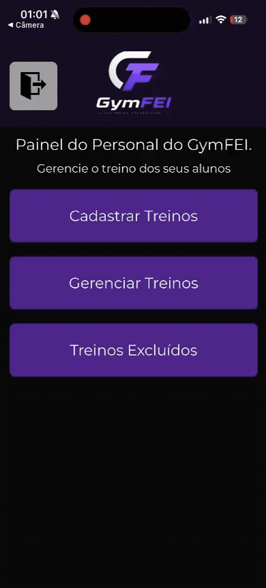

# 🏋️ GymFEI

Aplicativo mobile desenvolvido pelo aluno Rafael Almeida Ferreira da Fundação Educacional Inaciana Padre Sabóia de Medeiros (FEI), utilizando React Native com Expo para gerenciamento de treinos de academia.

O sistema foi criado com o objetivo de auxiliar alunos e administradores no acompanhamento de treinos, organização de exercícios e monitoramento de progresso físico.

---

# 📖 Visão Geral e Requisitos

## 📌 Tema do Projeto

O GymFEI é um aplicativo mobile voltado para gerenciamento de treinos de academia, permitindo que usuários acompanhem exercícios e progresso físico de forma prática e intuitiva.

## 🎯 Objetivos

* Desenvolver um aplicativo mobile funcional utilizando React Native.
* Aplicar conceitos de desenvolvimento mobile e integração com banco de dados.
* Criar uma interface intuitiva para usuários e administradores.
* Implementar funcionalidades de autenticação e gerenciamento de treinos.

## ✅ Requisitos do Projeto

* Sistema de login e cadastro.
* Gerenciamento de treinos.
* Navegação entre telas.
* Integração com Firebase.
* Persistência de dados.
* Interface responsiva e organizada.

---

# 🚀 Tecnologias Utilizadas

## 📱 Front-end

* React Native
* Expo
* JavaScript

## 🧭 Navegação

* React Navigation

## 🔥 Banco de Dados / Backend

* Firebase

## 💾 Armazenamento Local

* AsyncStorage

## 🎨 Estilização

* StyleSheet (React Native)

---

# ⚙️ Funcionalidades

## 👨‍🏫 Área do Administrador

### ➕ Cadastro de Treinos

Permite que o administrador crie novos treinos para os usuários.

### ✏️ Edição de Treinos

Possibilita alterar informações de treinos cadastrados.

### 🗂️ Gerenciamento de Exercícios

Organização de exercícios por grupo muscular e objetivo.

### 👥 Controle de Usuários

Gerenciamento básico de alunos e seus respectivos treinos.

---

## 👤 Área do Usuário

### 🔐 Login e Cadastro

Sistema de autenticação utilizando Firebase.

### 📋 Visualização de Treinos

Usuário pode acessar sua lista de treinos cadastrados.

### ▶️ Início de Treinos

Tela dedicada para iniciar e acompanhar exercícios.

### 📈 Acompanhamento de Progresso

Exibição de informações relacionadas ao desempenho do aluno.

---

## 🔥 Recursos Gerais

* Navegação entre múltiplas telas.
* Persistência de dados com Firebase.
* Armazenamento local com AsyncStorage.
* Estrutura organizada por componentes.
* Interface responsiva para dispositivos móveis.

---

# 🎥 Demonstração

## 📱 Aplicativo em Funcionamento

### 💪 Criando um treino (Administrador/Personal)

```md

```

### 🏋️‍♂️ Começando um treino (Usuário/Aluno)

```md
![Vídeo de Demonstração]gym-fei/assets/demo-usu.gif)
```

---

# 📂 Estrutura do Projeto

```bash
gym-fei/
│
├── assets/
│   ├── fonts/
│   └── img/
│
├── components/
│   ├── CadastrarTreino.js
│   ├── Cadastro.js
│   ├── EditarTreino.js
│   ├── GerenciarTreino.js
│   ├── HomeAdmin.js
│   ├── HomeUsuario.js
│   ├── IniciarTreino.js
│   ├── Login.js
│   ├── ProgressoAluno.js
│   ├── ScreenContainer.js
│   └── Treinos.js
│
├── config/
│   └── config.js
│
├── navigation/
│   └── AppNavigator.js
│
├── App.js
├── index.js
├── app.json
├── package.json
└── .gitignore
```

---

# ⚙️ Instalação e Execução

## 1️⃣ Clone o repositório

```bash
git clone <URL_DO_REPOSITORIO>
```

## 2️⃣ Entre na pasta do projeto

```bash
cd gym-fei
```

## 3️⃣ Instale as dependências

```bash
npm install
```

ou

```bash
yarn install
```

---

## ▶️ Executando o Projeto

### Iniciar com Expo

```bash
npm start
```

### Executar no Android

```bash
npm run android
```

### Executar no iOS

```bash
npm run ios
```

### Executar na Web

```bash
npm run web
```

---

# 🔐 Configuração do Firebase

Configure suas credenciais no arquivo:

```bash
config/config.js
```

Exemplo:

```javascript
const firebaseConfig = {
  apiKey: "SUA_API_KEY",
  authDomain: "SEU_AUTH_DOMAIN",
  projectId: "SEU_PROJECT_ID",
  storageBucket: "SEU_STORAGE_BUCKET",
  messagingSenderId: "SEU_MESSAGING_SENDER_ID",
  appId: "SEU_APP_ID"
};
```

---

# 📦 Dependências Principais

```json
{
  "expo": "~54.0.33",
  "firebase": "^9.23.0",
  "@react-navigation/native": "^7.2.2",
  "@react-navigation/native-stack": "^7.14.12",
  "@react-native-async-storage/async-storage": "^2.2.0"
}
```

---

# 🧠 Aprendizados e Próximos Passos

## 📚 Aprendizados

Durante o desenvolvimento do GymFEI, foram aplicados conhecimentos importantes relacionados a:

* Desenvolvimento mobile com React Native.
* Componentização.
* Navegação entre telas.
* Integração com Firebase.
* Persistência de dados.
* Estruturação de projetos.
* CRUD de informações.

O projeto contribuiu significativamente para o aprendizado prático de desenvolvimento mobile e integração entre front-end e banco de dados.

---

## 🚀 Próximos Passos

* Upload de imagens.
* Sistema de notificações.
* Cronômetro de treino.
* Histórico completo de treinos.
* Dashboard com gráficos.
* Sistema de avaliação física.

---

# 👨‍💻 Desenvolvedor

Projeto desenvolvido para fins acadêmicos e prática de desenvolvimento mobile com React Native.
